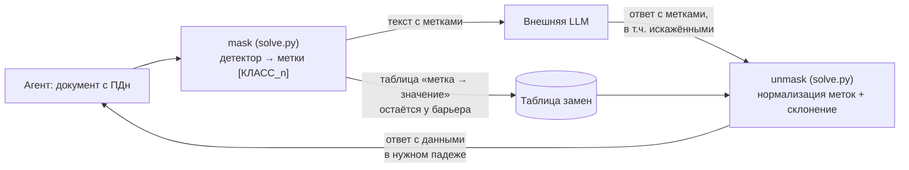
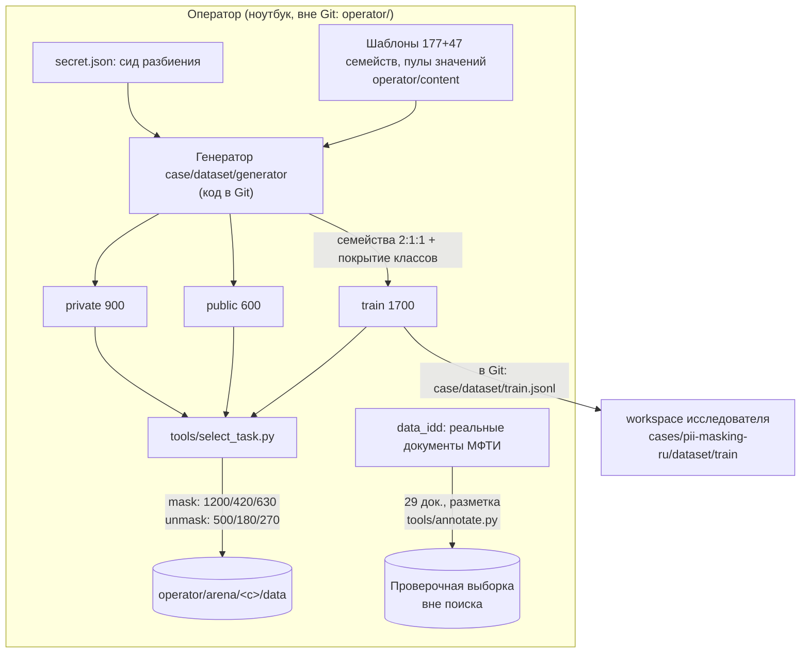
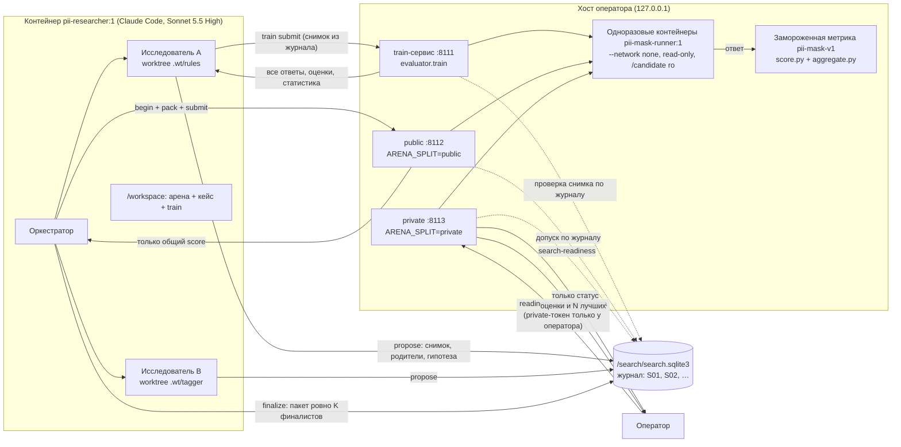
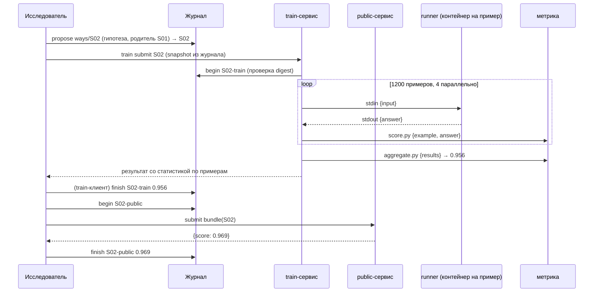

# Блок-схема: решение и потоки данных

## 1. Барьер в работе агента (что выращиваем)

Арена `mask` выращивает левую часть (детектор и расстановку меток), арена `unmask` — правую (восстановление). Это два отдельных этапа с общим baseline (ADR-0006).

## 2. Данные: от генератора до оценщиков

## 3. Одна арена во время поиска (mask; unmask устроена так же)

Граница изоляции — права доступа: в контейнер исследователя смонтированы только `workspace/`, каталог журнала и submit-токены train и public. Private-токен и отправка финалистов — у оператора. Данных public/private, генератора с шаблонами и реальной выборки в нём нет (`/Users` в контейнере отсутствует). Оценщики слушают только 127.0.0.1 хоста, исследователь ходит к ним через `host.docker.internal` с токеном.

## 4. Путь одного кандидата

