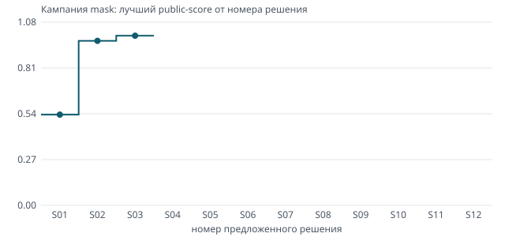
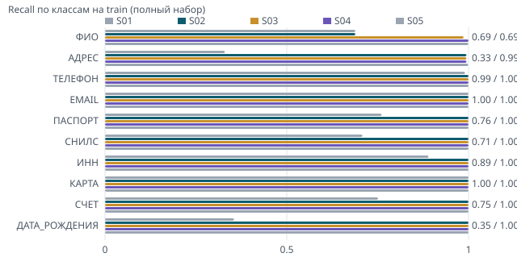
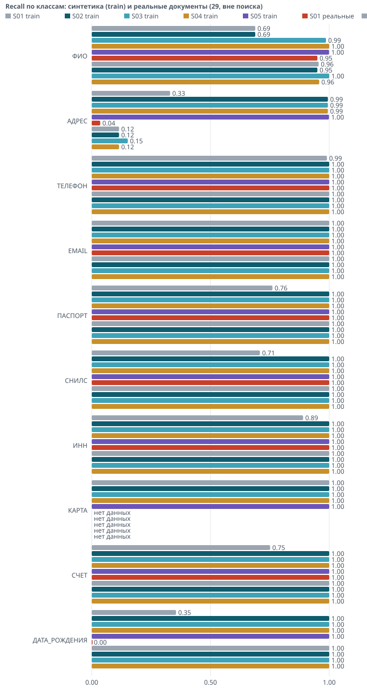
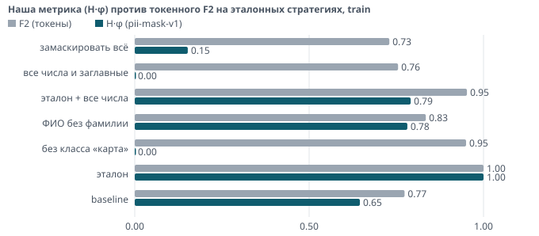
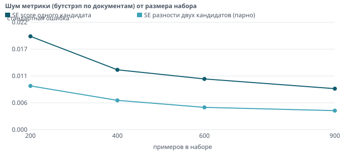

# Графики и анализ показателей (ЧП2)

Все графики пересобираются командами `uv run python tools/charts.py`, `tools/evolution_report.py mask` и `tools/train_analysis.py`. Данные под ними лежат в `results/`.

## 1. Кривая эволюции (арена mask, public)

Лучший public-score от номера предложенного решения (`right_step`, maximize, метрика `pii-mask-v1` на наборе mask = H·φ). Первая же гипотеза (S02) дала скачок 0.535 → 0.969: весь лёгкий выигрыш был в форматах структурных классов. Дальше кривая растёт медленнее, потому что остался один класс — ФИО. AUC по протоколу арены считается только по public и только когда public-оценки есть у всех 12 предложений, поэтому сейчас она неполная.

## 2. Recall по классам: что именно дало улучшение

S01 → S02 подняли адрес (0.33 → 0.99), дату рождения (0.35 → 1.00), паспорт, СНИЛС, счёт и ИНН до 1.00, а **ФИО не изменилось (0.69)**. По итоговому score этого не видно: гармоническое среднее 0.956 «выглядит хорошо», хотя треть ФИО на train открыта. Отсюда направление следующей ветки — ФИО: S03 (словарь имён с падежами, суффиксы отчеств, NER natasha) поднял ФИО до 0.986, train до 0.998 и public до 0.999. Таблица пропусков с примерами — `results/evolution/mask/train_analysis/report.md`.

## 3. Синтетика против реальных документов

На 29 реальных документах (вне поиска, только агрегаты) номера, телефоны и почты переносятся полностью. Два класса ведут себя противоположно:
- **ФИО** на реальных документах проще (0.95–0.96): в официальных бумагах имена записаны полностью и с заглавной буквы;
- **адрес** почти не находится (0.12 у S02 при 0.99 на train): реальные адреса записаны одной строкой, без пробелов, в верхнем регистре, а правила выросли на формах генератора.

S03 улучшил ФИО на синтетике, но на реальных документах ФИО и так 0.95, а precision упал 0.992 → 0.952 (словарь имён находит лишнее). S04 (обучаемый теггер, лучший на public 0.9997) на реальных документах даёт precision 0.593 и score 0.267 — хуже S02. Чем лучше кандидат на синтетике, тем хуже на реальных документах: это прямое свидетельство главного риска синтетики — эволюция учит генератор. Private (тот же генератор) этого не покажет, а реальная выборка показывает. Дата рождения на реальных документах — одна сущность, поэтому 0 → 1 там не статистика, а один пример.

## 4. Почему такая метрика: сравнение с F2

Токенный F2 (рекомендация Presidio для ПДн) ставит «замаскировать всё» на 0.73, почти вровень с baseline (0.77), и почти не замечает пропуск целого класса (без карт — 0.95). Наша метрика даёт 0.15 и 0: штраф φ за precision ниже 0.9 и гармоническое среднее по классам. Чувствительность к параметрам (порог, степень, кредит за частичное) — `results/metric_sensitivity/params.md`: ни одно соседнее значение не меняет порядок стратегий.

## 5. Шум метрики и размеры разделов

Бутстрэп по документам на baseline. На public (420–600 примеров) стандартная ошибка score одного кандидата около 0.01–0.015, а ошибка **разности** двух кандидатов на тех же примерах — около 0.005. Поэтому разницы порядка 0.01 и больше различимы: скачки S01 → S02 (+0.43 на public) и S02 → S03 (+0.04 на train) намного больше шума. Этим обоснован размер public (`case/dataset/README.md`).
