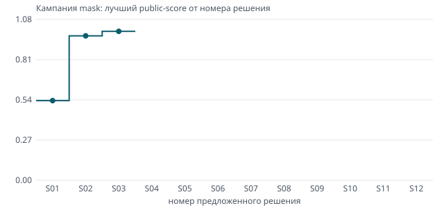
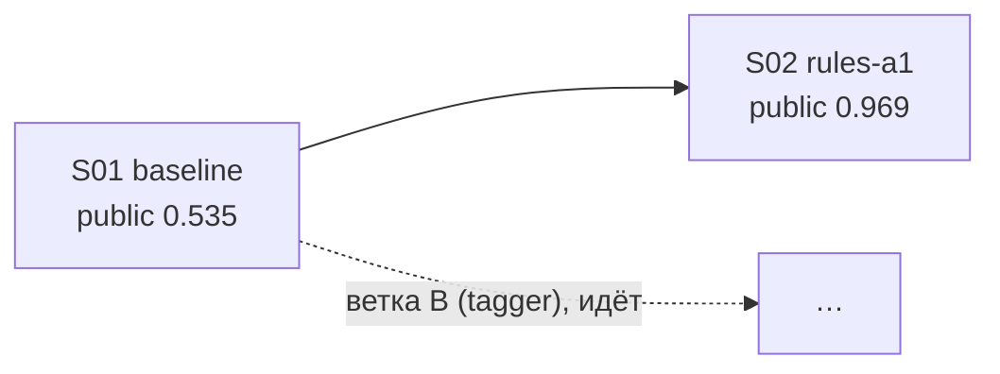

# Разбор эволюции — черновик к ЧП2

Состояние на 2026-11-20, 14:05. Арена `mask` — поиск начат и **приостановлен лимитом подписки Pro** (сброс в 17:10 МСК), продолжение — `run.sh mask continue` в той же сессии. Арена `unmask` подготовлена, это следующий этап. Отчёт строится из журнала командой `uv run python tools/evolution_report.py mask` (→ `results/evolution/mask/`).

## Запуски
| Запуск | Что | Команда | Итог |
|---|---|---|---|
| acceptance (учебный контур) | приёмка всего пути на открытых данных, лимит 3 | `deploy/local/arena_ops.py prepare/start acceptance` | пройден; найдены 3 проблемы окружения (см. «Проблемы») — `results/acceptance/` |
| mask, попытка 1 (13:1x) | запуск исследователя | `bash deploy/researcher/run.sh mask start` | **сбой до старта**: `RESUME[@]: unbound variable` (bash 3.2 macOS, пустой массив при `set -u`); модель не вызывалась, журнал не тронут |
| mask, попытка 2 (13:21–13:41) | та же кампания, тот же журнал и условия | то же после исправления скрипта | S01, S02 зарегистрированы и измерены; ветка B (ФИО) работала, кандидата не зарегистрировала; в 13:41 — «You've hit your 5-hour limit · resets 2:10pm (UTC)»; контейнер остановлен оператором в 14:04, сессия сохранена |
| unmask | — | `run.sh unmask start` после завершения mask | не начат |

Попытка 2 — продолжение той же кампании (журнал `pii-mask-c1` пустой до неё), а не новая кампания: условия, метрика, данные и release не менялись.

## Кривая и AUC

Метрика — `pii-mask-v1` на наборе mask (H(recall по классам) · φ(precision)), раздел **public** (420 примеров), направление maximize, лучший score по номеру решения (`right_step`). AUC по протоколу арены считается только по public и только когда public-оценку имеют все 12 предложений: сейчас 2 из 12 → AUC неполная (`results/evolution/mask/curve.json`).

| Решение | Родитель | Гипотеза | train | public |
|---|---|---|---|---|
| S01 | — | baseline: 13 регулярок | 0.6455 | 0.5346 |
| S02 | S01 | слабые классы теряют recall из-за узких форматов, а не неоднозначности: расширить форматы + контекст + контрольные суммы | 0.9563 | 0.9689 |

Полный журнал (все предложения и замеры, в том числе неудачные) — `results/evolution/mask/export.json`; снимки — в журнале, восстанавливаются `evaluator.search restore --candidate S02`.

## Родословная

Оркестратор разбил поиск на две независимые ветки (`results/evolution/mask/research/methods.md`): **A** — структурные классы, контекст и контрольные суммы (`res-rules`, до 4 мест); **B** — ФИО через NER/морфологию natasha и обучаемый на train токен-теггер с group-CV по семействам (`res-tagger`, до 4 мест); резерв 3 места — комбинация A+B и раунд альтернатив при плато.

## Эпизод 1: удачная попытка (S01 → S02)
- **Гипотеза** (в журнале): у АДРЕС 0.33, ДАТА_РОЖДЕНИЯ 0.36, ПАСПОРТ 0.76, СНИЛС 0.71, СЧЕТ 0.75, ИНН 0.89 recall теряется на форматах, которые baseline не знает, а не на неоднозначности.
- **Изменение** (`solve.py`, 83 → 291 строка): адрес — ядро «тип улицы + название + дом» с необязательным «д.», формы «5-321» и чатовая, индекс/регион/город слева по запятым; дата рождения — 5 форматов, но метка только по контексту («рождения/родился/др» слева, «г.р.» справа, дата сразу после ФИО); паспорт со словами «номер/№» и слитный; СНИЛС и ИНН — по ключевому слову **или контрольной сумме**; счёт группами; телефон с последней группой 2–3 цифры; приоритет классов при пересечениях. Правила ФИО не менялись.
- **Регистрация и оценка:** S02 (родитель S01) → train 0.9563 → public 0.9689.
- **Проверка по классам** (`results/evolution/mask/train_analysis/report.md`): все классы кроме ФИО → 0.99–1.00; **ФИО без изменений — 0.689** (1254 пропущенных сущности: «Богдан Жуковский», «Тимофей Пак», нижний регистр в чатах). Гармоническое среднее теперь ограничено ФИО — это и есть направление ветки B. Precision не упал (0.997): контекстные условия для дат и контрольные суммы не дали ложных срабатываний.
- **Вывод:** ожидание оправдалось; выигрыш — от структурных классов, а не от ФИО. Train ≈ public, признаков подгонки под train нет (семейства и значения в public другие).

## Эпизод 2: неудачи и сбои
0. **Лимит подписки Pro (13:41).** Оркестратор запустил двух исследователей в фоне и поставил запасное пробуждение через час; через 20 минут работы сессия получила «You've hit your 5-hour limit». Самоотчёт харнеса: $3.31 в пересчёте на API, 214 сообщений основного агента. Ветка B (теггер ФИО) не успела зарегистрировать кандидата — место в лимите не потрачено, журнал согласован. Вывод: узкое место кампании — лимит подписки, а не вычисления (оценка кандидата — около 3 минут); на 12 решений нужно 2–3 окна по 5 часов или второй аккаунт с той же моделью.
1. **Сбой запуска исследователя** (попытка 1): первая строка `.err` — `RESUME[@]: unbound variable`. Причина — `${RESUME[@]}` при пустом массиве и `set -u` в bash 3.2. Подтверждение: `bash -n` и повторный запуск после правки на `${RESUME[@]+"${RESUME[@]}"}` — исследователь стартовал, журнал до этого пустой. Влияние на лимит и оценки — нет.
2. **Train-сбой на приёмке:** `FileNotFoundError: 'slot-1.lock'` после первого успешно оценённого примера — общий файловый пул слотов (`ARENA_SLOT_DIR`) на macOS. Обход — без общего пула, параллельность через `ARENA_EXECUTION_SLOTS`. Повторная отправка того же кандидата вернула **сохранённый failed-результат** (идемпотентность train по снимку и подвыборке) — понадобилась другая подвыборка.
3. **Runner-сбой на приёмке:** `bind source path does not exist` от Docker Desktop сразу после пересоздания каталога состояния; через минуту тот же mount работал. Вывод: не пересоздавать каталоги работающей кампании.
4. **Ложный ноль:** baseline на 12 примерах приёмки получил 0.0 — не ошибка, а гармоническое среднее, обнуляемое классом без единой найденной сущности; учтено в стартовом промпте (представительные подвыборки).

## Перенос на реальные документы (вне поиска)
| | Синтетика public | Реальные документы (29) | ФИО real | АДРЕС real |
|---|---|---|---|---|
| S01 | 0.535 | 0.000 (пропущена единственная дата рождения) | 0.95 | 0.04 |
| S02 | 0.969 | 0.538 | 0.96 | **0.12** |

S02 поднял и реальный score, но адреса на реальных документах почти не находятся при 0.994 на синтетике: в реальных счетах адрес — одна строка в верхнем регистре или без пробелов («000000,Областьобласть,г.Город,ул.Примерная,1-2» — вымышленный пример того же вида), а правила выращены на формах генератора. Это прямое свидетельство того, что эволюция учит особенности генератора — главный риск синтетики из реестра. Исследователи эти данные не видят; вывод — для генератора v2 и для разбора на защите.

## Что видно и чего не видно по итоговому score
- По score не видно, что выигрыш S02 пришёл целиком от структурных классов, а ФИО не сдвинулось: это видно только по recall классов.
- По score не видно и разрыва синтетика ↔ реальные документы в адресах.
- Один скачок за одно решение: кривая пока не говорит ничего о сходимости.

## Дальше
Довести mask до 12 предложений, ревью и финализация (K = 3, N = 1), private; затем арена unmask (6 предложений). Абляция S02 по компонентам (адрес / дата / контрольные суммы), сравнение ветки B с NER natasha как классическим подходом, финальная оценка финалистов на реальной выборке.
