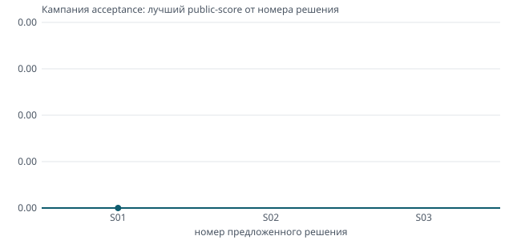
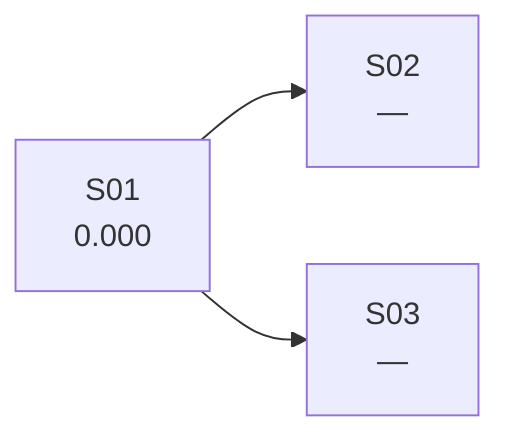

# Эволюция: кампания `acceptance`

Предложено: 3 из 3. Public-оценок: 1. Лучший public: 0.0. AUC (public, right_step, горизонт 3): неполная — нужны public-оценки всех предложений.

## Родословная

## Кандидаты

| Решение | Родители | Гипотеза | Изменение | train | public |
|---|---|---|---|---|---|
| S01 | — | Стартовая точка | baseline без изменений | 0.000 | 0.000 |
| S02 | S01 | приёмка: вариант 2 | комментарий в solve.py | — | — |
| S03 | S01 | приёмка: вариант 3 | комментарий в solve.py | — | — |

Состояние журнала: {"stopped": false, "finalization": {"batch_digest": "55552280956714ffebabb1450780249c3a430feabbd3b91bdc5918477c3e05a0", "finalized_at": "2026-11-20T09:48:41.603729+00:00"}}
