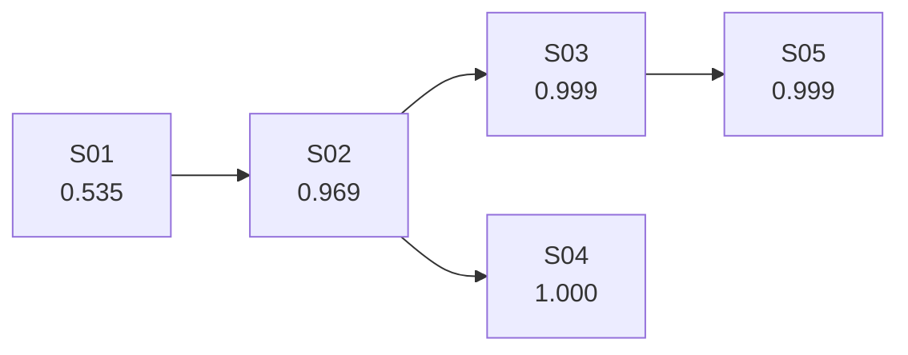

# Эволюция: кампания `mask`

Предложено: 5 из 12. Public-оценок: 5. Лучший public: 0.9997149488944089. AUC (public, right_step, горизонт 12): неполная — нужны public-оценки всех предложений.

## Родословная

## Кандидаты

| Решение | Родители | Гипотеза | Изменение | train | public |
|---|---|---|---|---|---|
| S01 | — | Исходная точка: 13 регулярок, высокий precision, низкий recall по АДРЕС/ДАТА_РОЖДЕНИЯ/ФИО | Без изменений: baseline кейса | 0.645 | 0.535 |
| S02 | S01 | Слабые классы baseline (АДРЕС .33, ДАТА_РОЖДЕНИЯ .36, ПАСПОРТ .76, СНИЛС .71, СЧЕТ .75, ИНН .89) теряют recall из-за узких форматов, а не из | Новые regex+контекст для АДРЕС (ядро улица+название+дом, левое расширение индекс/регион/город по запятым), ДАТА_РОЖДЕНИЯ (форматы + контекст | 0.956 | 0.969 |
| S03 | S02 | Потери recall ФИО (0.689) вызваны узкими шаблонами baseline: пропускаются склонённые имена/отчества, пары Имя Фамилия, одиночные имена и ниж | Добавлен fio_spans в solve.py: словарь имён (общие знания) с порождением падежей, неоднозначные имена с условиями, отчества/фамилии по суффи | 0.998 | 0.999 |
| S04 | S02 | Остаток ошибок S02 — ФИО (recall .689). Обучаемый токен-теггер без идентичности слов (форма/регистр, суффиксы 1-4, словарь имён общего знани | Добавлен теггер ФИО (tagfeat.py, names_ru.py, weights.json, обучены на train; порог 0.07) поверх структурных правил S02 (rules_a1.py = S02); | 0.999 | 1.000 |
| S05 | S03 | Остаточные ошибки S03 на train (FN ФИО 63, FN АДРЕС 8, FP ФИО ~97 слов) и режимы отказа на сдвинутых вымышленных строках вызваны не нехватко | Новый каталог ways/robust-x1 (копия names-n1 + правки): горизонтальные пробелы в ФИО-шаблонах и инициалах; обрезка ведущих обращений/титулов | 1.000 | 0.999 |

Состояние журнала: {"stopped": false, "finalization": null}
