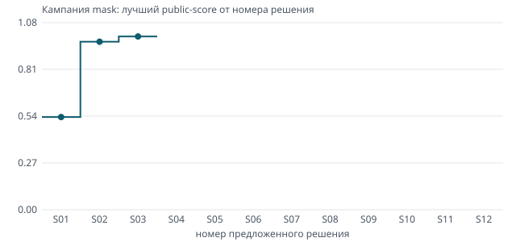
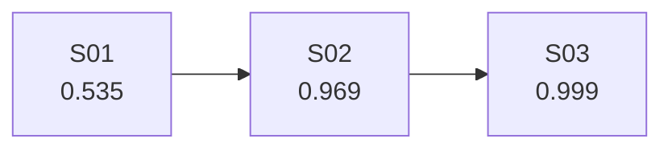

# Эволюция: кампания `mask`

Предложено: 3 из 12. Public-оценок: 3. Лучший public: 0.9991198084048062. AUC (public, right_step, горизонт 12): неполная — нужны public-оценки всех предложений.

## Родословная

## Кандидаты

| Решение | Родители | Гипотеза | Изменение | train | public |
|---|---|---|---|---|---|
| S01 | — | Исходная точка: 13 регулярок, высокий precision, низкий recall по АДРЕС/ДАТА_РОЖДЕНИЯ/ФИО | Без изменений: baseline кейса | 0.645 | 0.535 |
| S02 | S01 | Слабые классы baseline (АДРЕС .33, ДАТА_РОЖДЕНИЯ .36, ПАСПОРТ .76, СНИЛС .71, СЧЕТ .75, ИНН .89) теряют recall из-за узких форматов, а не из | Новые regex+контекст для АДРЕС (ядро улица+название+дом, левое расширение индекс/регион/город по запятым), ДАТА_РОЖДЕНИЯ (форматы + контекст | 0.956 | 0.969 |
| S03 | S02 | Потери recall ФИО (0.689) вызваны узкими шаблонами baseline: пропускаются склонённые имена/отчества, пары Имя Фамилия, одиночные имена и ниж | Добавлен fio_spans в solve.py: словарь имён (общие знания) с порождением падежей, неоднозначные имена с условиями, отчества/фамилии по суффи | 0.998 | 0.999 |

Состояние журнала: {"stopped": false, "finalization": null}
