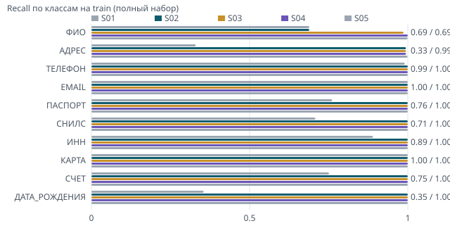

# Разбор train-результатов

## S01: score 0.6455 · H 0.645 · P 0.996 · невалидных 0

| Класс | recall | пропущено сущностей | примеры пропусков |
|---|---|---|---|
| ФИО | 0.689 | 1254 | `Богдан Жуковский`; `Гольдман Татьяны Маратовны`; `Тимофей Пак`; `арсений` |
| АДРЕС | 0.330 | 895 | `г. Ижевск, наб. Победы, д. 167В, кв. 334`; `г. Астрахань, ул. Ленина, дом 50, кв. 307`; `528077, Оренбург, улица Кутузова, д. 36, корп. 4, кв. 342`; `г. Казань, ул. Изумрудная, дом 108, кв. 296` |
| ТЕЛЕФОН | 0.990 | 9 | `+7 (345) 284-56-816`; `+7 (345) 265-01-389`; `8 (345) 250-40-719`; `+7 345 250 40 719` |
| EMAIL | 1.000 | 0 |  |
| ПАСПОРТ | 0.761 | 316 | `5406`; `372475`; `0225`; `384399` |
| СНИЛС | 0.708 | 195 | `76068044510`; `34700557258`; `203 783 240 46`; `16774157706` |
| ИНН | 0.890 | 60 | `4059 3435 6470`; `5598 5574 3581`; `0216 1921 6480`; `5862 2639 3743` |
| КАРТА | 1.000 | 0 |  |
| СЧЕТ | 0.751 | 132 | `40817 810 2 7971 5098335`; `40817 810 1 5046 2143468`; `40817 810 1 5046 2143468`; `40817 810 9 6523 4538492` |
| ДАТА_РОЖДЕНИЯ | 0.355 | 349 | `2 ноября 2005`; `8 июля 1966`; `19 декабря 1996`; `08.06.1964` |

Чаще всего лишне замаскированные токены: `Дорогая`×31, `Дорогой`×28, `Уважаемый`×17, `Уважаемая`×16, `Контактный`×7, `телефон`×7

## S02: score 0.9563 · H 0.956 · P 0.997 · невалидных 0

| Класс | recall | пропущено сущностей | примеры пропусков |
|---|---|---|---|
| ФИО | 0.689 | 1254 | `Богдан Жуковский`; `Гольдман Татьяны Маратовны`; `Тимофей Пак`; `арсений` |
| АДРЕС | 0.994 | 8 | `236611, Санкт-Петербург, ул. Гвардейская, д.166/12, кв. 44`; `Санкт-Петербург, б-р Рябиновая, д. 13, кв. 360`; `675352, Московская обл., Петрово-Дальнее, ул. Чапаева, дом 120, кв. 359`; `ш Космодемьянской 171, корп. 4 кв 361` |
| ТЕЛЕФОН | 1.000 | 0 |  |
| EMAIL | 1.000 | 0 |  |
| ПАСПОРТ | 1.000 | 0 |  |
| СНИЛС | 1.000 | 0 |  |
| ИНН | 1.000 | 0 |  |
| КАРТА | 1.000 | 0 |  |
| СЧЕТ | 1.000 | 0 |  |
| ДАТА_РОЖДЕНИЯ | 1.000 | 0 |  |

Чаще всего лишне замаскированные токены: `Дорогая`×31, `Дорогой`×28, `Уважаемый`×17, `Уважаемая`×16, `24`×1, `12`×1, `2024`×1

## S03: score 0.9981 · H 0.998 · P 0.997 · невалидных 0

| Класс | recall | пропущено сущностей | примеры пропусков |
|---|---|---|---|
| ФИО | 0.986 | 63 | `Наталья Фёдоровна`; `Эльвира Титова`; `Зарина Морозова`; `богдан михайлович` |
| АДРЕС | 0.994 | 8 | `236611, Санкт-Петербург, ул. Гвардейская, д.166/12, кв. 44`; `Санкт-Петербург, б-р Рябиновая, д. 13, кв. 360`; `675352, Московская обл., Петрово-Дальнее, ул. Чапаева, дом 120, кв. 359`; `ш Космодемьянской 171, корп. 4 кв 361` |
| ТЕЛЕФОН | 1.000 | 0 |  |
| EMAIL | 1.000 | 0 |  |
| ПАСПОРТ | 1.000 | 0 |  |
| СНИЛС | 1.000 | 0 |  |
| ИНН | 1.000 | 0 |  |
| КАРТА | 1.000 | 0 |  |
| СЧЕТ | 1.000 | 0 |  |
| ДАТА_РОЖДЕНИЯ | 1.000 | 0 |  |

Чаще всего лишне замаскированные токены: `Дорогая`×31, `Дорогой`×28, `Уважаемый`×17, `Уважаемая`×16, `Владимир`×4, `24`×1, `12`×1, `2024`×1, `Протокол`×1

## S04: score 0.9994 · H 0.999 · P 0.997 · невалидных 0

| Класс | recall | пропущено сущностей | примеры пропусков |
|---|---|---|---|
| ФИО | 1.000 | 0 |  |
| АДРЕС | 0.994 | 8 | `236611, Санкт-Петербург, ул. Гвардейская, д.166/12, кв. 44`; `Санкт-Петербург, б-р Рябиновая, д. 13, кв. 360`; `675352, Московская обл., Петрово-Дальнее, ул. Чапаева, дом 120, кв. 359`; `ш Космодемьянской 171, корп. 4 кв 361` |
| ТЕЛЕФОН | 1.000 | 0 |  |
| EMAIL | 1.000 | 0 |  |
| ПАСПОРТ | 1.000 | 0 |  |
| СНИЛС | 1.000 | 0 |  |
| ИНН | 1.000 | 0 |  |
| КАРТА | 1.000 | 0 |  |
| СЧЕТ | 1.000 | 0 |  |
| ДАТА_РОЖДЕНИЯ | 1.000 | 0 |  |

Чаще всего лишне замаскированные токены: `Дорогая`×31, `Дорогой`×28, `Уважаемый`×17, `Уважаемая`×16, `ку`×3, `24`×1, `12`×1, `2024`×1
